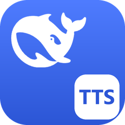

# DeepSeek 语音合成（TTS）

基于 [DeepSeek 官方语音合成接口](https://api-docs.deepseek.com/zh-cn/guides/tts) 的 Windows 原生桌面软件：
输入文本 → 调用接口生成语音 → 直接播放 → 保存为文件。

不依赖浏览器、不起本地服务、不需要命令行。



## 特性

- **原生桌面界面**（WPF / .NET 8），不是套壳网页
- **两种音色**：海星（女声，默认）、暗潮（男声）
- **格式遵循官方说明，不做任何转换**：WAV 原样保存，PCM 保存原始裸流
- **页面内播放**：播放/暂停、拖动进度、时间显示
- **API Key 在应用内配置**，加密框掩码，只存本机
- **临时缓存完整管理**：TTL 回收、容量上限、异常残留清理
- 两种分发方式：安装包 / 免安装单文件

## 安装

从 [Releases](../../releases) 下载：

| 文件 | 说明 |
| --- | --- |
| `DeepSeekTTS-Setup-x.y.z.exe` | 安装包，创建快捷方式与卸载项（推荐） |
| `DeepSeekTTS.exe` | 免安装单文件，双击即用 |

自包含 .NET 运行时，目标机器无需安装任何环境。

## 使用

1. 首次启动会弹出设置窗口，填入 DeepSeek API Key
2. 输入要朗读的文本（支持普通话、粤语、英语、日语、韩语等，语种自动识别）
3. 选择音色与格式，点击「生成语音」
4. 播放试听，或点击「下载」保存

配置保存在 `%APPDATA%\DeepSeekTTS\`，Key 只存本机，不会上传。

## 音频格式说明

官方只提供两种格式，均按原样保存、原样下载：

- **`wav`**：标准 RIFF/WAVE，可直接播放
- **`pcm`**：不含容器头的裸流（24 kHz / 16 bit / 单声道），无法直接播放

处理方式（见 [WavHelper.cs](Services/WavHelper.cs)）：

- **WAV**：接口是流式返回的，`data` 长度字段可能是 `0xFFFFFFFF`（未知占位），
  直接播放会抛异常。播放前按实际字节数回填头部，生成**仅供播放的内存副本**。
- **PCM**：内存中补 44 字节 WAV 头供播放。

原则：**只修补容器头，绝不动采样数据**（有逐字节断言）。
写入磁盘与「下载」始终使用接口返回的原始字节，格式完全遵循官方说明。

## 临时缓存管理

| 环节 | 做法 |
| --- | --- |
| 写入 | 先写 `.part` 再原子改名，避免半截文件 |
| 完整性校验 | WAV 校验 RIFF 头；PCM 校验偶数对齐 |
| 过期回收 | 30 分钟未访问自动删除 |
| 容量上限 | 最多 20 段 / 1 GiB，按最久未使用淘汰 |
| 启动清理 | 启动时清空（兜底崩溃残留） |
| 主动删除 | 界面按钮；重新生成前自动清理 |

## 从源码构建

```bash
dotnet run          # 开发运行

# 发布单文件 exe（约 63 MB）
dotnet publish -c Release -r win-x64 --self-contained true ^
  -p:PublishSingleFile=true -p:IncludeNativeLibrariesForSelfExtract=true ^
  -p:EnableCompressionInSingleFile=true -o publish

# 生成安装包（需 Inno Setup 6，约 58 MB）
ISCC installer.iss
```

> `installer.iss` 必须保存为 **带 BOM 的 UTF-8**，否则中文字符串会乱码。

图标由 `scripts/make-icon.py` 生成（需 Pillow）。

## 测试

组件测试共 19 项，使用 mock 上游，不需要真实 API Key，不消耗额度：

```bash
node scripts/mock-upstream.js                                  # 终端 A
set DEEPSEEK_TTS_BASE=http://127.0.0.1:4300
dotnet run --project tests/TtsTests.csproj                     # 终端 B
```

`MOCK_STREAMING_WAV=1` 可复现真实接口的流式 WAV（data 长度为 0xFFFFFFFF）场景。

## 环境变量（可选）

| 变量 | 说明 |
| --- | --- |
| `DEEPSEEK_API_KEY` | 提供 Key 的另一种方式（优先级低于应用内保存的） |
| `DEEPSEEK_TTS_DATA` | 覆盖配置与缓存目录 |
| `DEEPSEEK_TTS_BASE` | 上游地址，仅测试时指向 mock |

## 项目结构

```
├── MainWindow.xaml / .cs       # 主窗口
├── SettingsWindow.xaml / .cs   # 设置窗口
├── Services/
│   ├── TtsClient.cs            # 接口调用、流式接收、错误映射
│   ├── WavHelper.cs            # WAV 头修复与 PCM 补头
│   ├── AudioPlayer.cs          # NAudio 播放
│   ├── TempAudioStore.cs       # 临时缓存管理
│   └── AppSettings.cs          # 配置持久化与脱敏
├── installer.iss               # Inno Setup 安装包脚本
├── tests/                      # 组件测试
└── .github/workflows/build.yml # CI：打 tag 自动构建并发布 Release
```

## 已知限制

- 仅 Windows（WPF）
- 使用整段合成接口，未实现 WebSocket 流式合成
- 官方限制：不支持调节语速、不支持中断续传、单次最长 30 分钟音频

## 许可

[MIT](LICENSE)

DeepSeek logo 及相关商标归 DeepSeek 所有，本项目仅用于标识所调用的官方服务，
不代表 DeepSeek 官方出品或背书。
